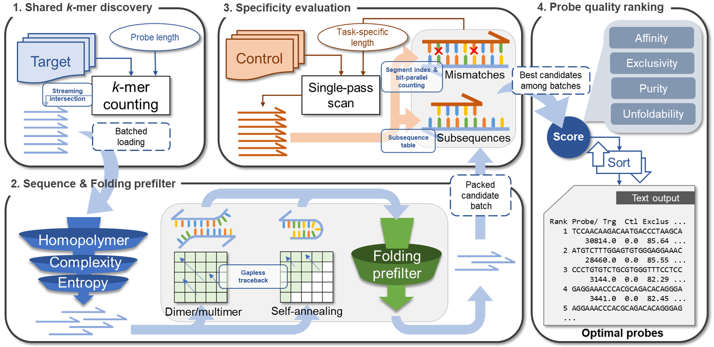

# NPSeeker v1

   
  Schematic representation of the NPSeeker probe design algorithm.

## About this software
NPSeeker (Nucleic Acid Probe Seeker) is a genome-driven nucleic acid probe design program for BioFET and other biochip-based species identification and group-classification tasks.

This software is published along with the following paper:

<table>
  <tr>
    <td>Authors</td>
    <td>Hao-Yu Peng, Hui Zhi Gan, Yu-Ching Chen, Chun-Erh Ou Yang, Yee-Lu Zhaog, Chia-Hua Lo, Yuh-Shyong Yang*, and Wei-Cheng Lo*</td>
  </tr>
  <tr>
    <td>Article</td>
    <td>NPSeeker: A BioFET-oriented Nucleic Acid Probe Design Algorithm for Efficient Species Identification and Classification</td>
  </tr>
  <tr>
    <td>Institutes</td>
    <td>Institute of Bioinformatics and Systems Biology, National Yang Ming Chiao Tung University, Hsinchu, Taiwan, Republic of China;  Institute of Molecular Medicine and Bioengineering, National Yang Ming Chiao Tung University, Hsinchu, Taiwan, Republic of China</td>
  </tr>
</table>
*Corresponding authors: Yuh-Shyong Yang (ysyang@nycu.edu.tw), Wei-Cheng Lo (WadeLo@nycu.edu.tw)

 
 

Download URLs: 
https://github.com/NYCU-10lab/NPSeeker 
https://10lab.ceb.nycu.edu.tw/NPSeeker/

## Download
Notice: This repository is currently under maintenance. In the meantime, please download the NPSeeker software and datasets from our official website (https://10lab.ceb.nycu.edu.tw/NPSeeker).
