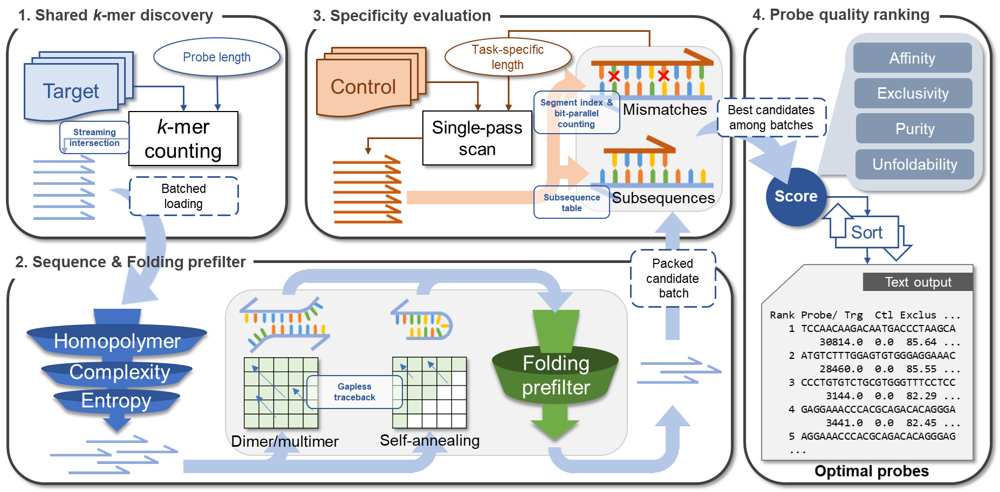
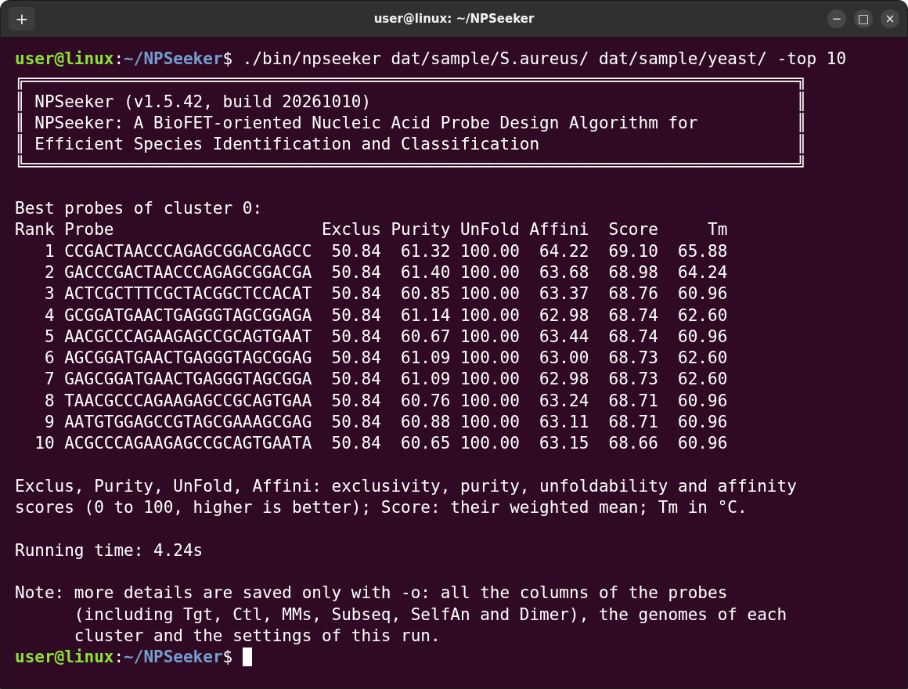
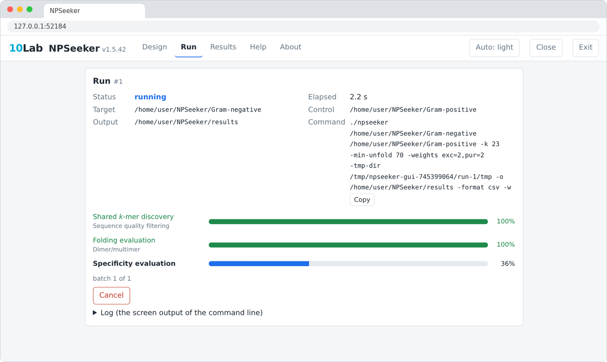

# NPSeeker v1.5.42

<p align="center">
  <br>
  Schematic representation of the NPSeeker probe design algorithm.
</p>

## About this software
NPSeeker (Nucleic Acid Probe Seeker) is a genome-driven nucleic acid probe design program for species identification and group classification using BioFETs and other biochip platforms.

Given target genomes (from organisms to be detected) and control genomes (from organisms that should not be detected), NPSeeker identifies DNA sequences shared by the targets, or within target clusters when necessary. It then ranks candidate probes using four scores: exclusivity, purity, unfoldability, and affinity. NPSeeker provides both a command-line interface and a browser-based graphical interface.

<table>
  <tr>
    <td>Authors</td>
    <td>Hao-Yu Peng, Hui Zhi Gan, Yu-Ching Chen, Chun-Erh Ou Yang, Yee-Lu Zhaog, Chia-Hua Lo, Yuh-Shyong Yang*, and Wei-Cheng Lo*</td>
  </tr>
  <tr>
    <td>Article</td>
    <td>NPSeeker: A BioFET-oriented Nucleic Acid Probe Design Algorithm for Efficient Species Identification and Classification</td>
  </tr>
  <tr>
    <td>Institutes</td>
    <td>Institute of Bioinformatics and Systems Biology, National Yang Ming Chiao Tung University, Hsinchu, Taiwan, Republic of China; </br>Institute of Molecular Medicine and Bioengineering, National Yang Ming Chiao Tung University, Hsinchu, Taiwan, Republic of China</td>
  </tr>
</table>
*Corresponding authors: Yuh-Shyong Yang (ysyang@nycu.edu.tw), Wei-Cheng Lo (WadeLo@nycu.edu.tw)

<br>
<br>

Download URLs:<br>
https://github.com/NYCU-10lab/NPSeeker<br>
https://10lab.ceb.nycu.edu.tw/NPSeeker/

## Download
<table border="1">
  <tr> 
    <td valign="top"> 
      <b>Standalone program</b><br>(written in Go, no installation needed)
    </td>
    <td>
      <table border="1" cellpadding="0" cellspacing="0" bordercolor="#DDDDDD">
        <tr>
          <td>Linux</td>
          <td nowrap>
            <a target="_blank" href="Programs/NPSeeker-1.5.42-Linux.tar.gz">.tar.gz</a>
            &nbsp;&nbsp;
            <a target="_blank" href="Programs/NPSeeker-1.5.42-Linux.zip">.zip</a>
          </td>
        </tr>
        <tr>
          <td>macOS</td>
          <td nowrap>
            <a target="_blank" href="Programs/NPSeeker-1.5.42-macOS.tar.gz">.tar.gz</a>
            &nbsp;&nbsp;
            <a target="_blank" href="Programs/NPSeeker-1.5.42-macOS.zip">.zip</a>
          </td>
        </tr>
        <tr>
          <td nowrap>Windows 10+</td>
          <td nowrap>
            <a target="_blank" href="Programs/NPSeeker-1.5.42-Windows.tar.gz">.tar.gz</a>
            &nbsp;&nbsp;
            <a target="_blank" href="Programs/NPSeeker-1.5.42-Windows.zip">.zip</a>
          </td>
        </tr>
      </table>
      Each archive contains NPSeeker for both x86_64 (bin/) and arm64 (bin.arm64/) computers.
      <table border="1" cellpadding="0" cellspacing="0" bordercolor="#DDDDDD">
        <tr>
          <td>Datasets</td>
          <td nowrap>
            <a target="_blank" href="https://10lab.ceb.nycu.edu.tw/NPSeeker/dat/downloads/prgs/NPSeeker-1.5.42-datasets.tar.gz">.tar.gz</a>
            &nbsp;&nbsp;
            <a target="_blank" href="https://10lab.ceb.nycu.edu.tw/NPSeeker/dat/downloads/prgs/NPSeeker-1.5.42-datasets.zip">.zip</a>
          </td>
        </tr>
      </table>
      Bacterial genomes used in the NPSeeker paper (optional). To run the examples in Chapter 8 of the user manual, move the datasets folder it contains (under NPSeeker/dat/) into the dat folder of NPSeeker.<br><br>
      <a target="_blank" href="Programs/NPSeeker-1.5.42-SHA256SUMS.txt">SHA-256 checksums</a>
      <p align="right">
        <br>
      </p>
    </td>
  </tr>
</table>

## User manual
<table class="in_table" cellspacing="0" cellpadding="0" bordercolor="#DDDDDD" border="1">
  <tr>
    <td style="padding:3px 10px;"><b>Language</b></td>
    <td align="center" style="padding:3px 10px;"><b>Link</b></td>
  </tr>
  <tr>
    <td nowrap="nowrap" style="padding:5px 10px;">Chinese</td>
    <td align="center" nowrap="nowrap" style="padding:5px 10px;">
      <a href="https://10lab.ceb.nycu.edu.tw/NPSeeker/dat/downloads/manuals/UserManual-zh-TW.html" target="_blank">中文 (繁)</a><br>
      <a href="https://10lab.ceb.nycu.edu.tw/NPSeeker/dat/downloads/manuals/UserManual-zh-CN.html" target="_blank">中文 (简)</a>
    </td>
  </tr>
  <tr>
    <td nowrap="nowrap" style="padding:5px 10px;">English</td>
    <td align="center" nowrap="nowrap" style="padding:5px 10px;">
      <a href="https://10lab.ceb.nycu.edu.tw/NPSeeker/dat/downloads/manuals/UserManual-en.html" target="_blank">English</a>
    </td>
  </tr>
  <tr>
    <td nowrap="nowrap" style="padding:5px 10px;">French</td>
    <td align="center" nowrap="nowrap" style="padding:5px 10px;">
      <a href="https://10lab.ceb.nycu.edu.tw/NPSeeker/dat/downloads/manuals/UserManual-fr.html" target="_blank">Français</a>
    </td>
  </tr>
  <tr>
    <td nowrap="nowrap" style="padding:5px 10px;">German</td>
    <td align="center" nowrap="nowrap" style="padding:5px 10px;">
      <a href="https://10lab.ceb.nycu.edu.tw/NPSeeker/dat/downloads/manuals/UserManual-de.html" target="_blank">Deutsch</a>
    </td>
  </tr>
  <tr>
    <td nowrap="nowrap" style="padding:5px 10px;">Japanese</td>
    <td align="center" nowrap="nowrap" style="padding:5px 10px;">
      <a href="https://10lab.ceb.nycu.edu.tw/NPSeeker/dat/downloads/manuals/UserManual-ja.html" target="_blank">日本語</a>
    </td>
  </tr>
  <tr>
    <td nowrap="nowrap" style="padding:5px 10px;">Korean</td>
    <td align="center" nowrap="nowrap" style="padding:5px 10px;">
      <a href="https://10lab.ceb.nycu.edu.tw/NPSeeker/dat/downloads/manuals/UserManual-ko.html" target="_blank">한국어</a>
    </td>
  </tr>
  <tr>
    <td nowrap="nowrap" style="padding:5px 10px;">Portuguese (Brazil)</td>
    <td align="center" nowrap="nowrap" style="padding:5px 10px;">
      <a href="https://10lab.ceb.nycu.edu.tw/NPSeeker/dat/downloads/manuals/UserManual-pt-BR.html" target="_blank">Português (Brasil)</a>
    </td>
  </tr>
  <tr>
    <td nowrap="nowrap" style="padding:5px 10px;">Thai</td>
    <td align="center" nowrap="nowrap" style="padding:5px 10px;">
      <a href="https://10lab.ceb.nycu.edu.tw/NPSeeker/dat/downloads/manuals/UserManual-th.html" target="_blank">ไทย</a>
    </td>
  </tr>
</table>

### 1. Download and extract
Download the archive for your operating system (Windows, macOS, or Linux; .tar.gz or .zip) from the <a href="https://10lab.ceb.nycu.edu.tw/NPSeeker/download.php" target="_blank">Downloads</a> page or the GitHub page. Each archive contains NPSeeker for both x86_64 computers (most Intel and AMD processors) and arm64 computers (such as Apple M-series Macs). NPSeeker requires no installation or additional analysis software.

Extract the archive into any folder:
* Windows: right-click the .zip file and choose "Extract All".
* macOS: double-click the archive.
* Linux: run the command below in a terminal (use unzip for the .zip file).

```bash
tar xzf NPSeeker-1.5.42-Linux.tar.gz
```

The first time you run NPSeeker, the system may warn you because the program is not signed:
* Windows: click "More info", then "Run anyway".
* macOS: in Terminal, run `xattr -dr com.apple.quarantine` followed by the path of the NPSeeker folder.
* Linux: if you see "permission denied", run `chmod +x bin/npseeker`.

### 2. Contents of the software folder
The extracted NPSeeker folder contains:

<table>
  <tr>
    <td>bin/</td>
    <td>NPSeeker for x86_64 processors (most Intel and AMD)</td>
  </tr>
  <tr>
    <td>bin.arm64/</td>
    <td>NPSeeker for arm64 processors (such as Apple M-series)</td>
  </tr>
  <tr>
    <td>doc/</td>
    <td>User manuals in several languages (.html; the .txt versions are in doc/txt/)</td>
  </tr>
  <tr>
    <td>dat/sample/</td>
    <td>Example data for a first run</td>
  </tr>
  <tr>
    <td>README.txt, LICENSE.txt</td>
    <td>Overview and license terms</td>
  </tr>
</table>

The bacterial genomes used in the NPSeeker paper are a separate download (Datasets on the <a href="https://10lab.ceb.nycu.edu.tw/NPSeeker/download.php" target="_blank">Downloads</a> page). You may extract it and move the datasets folder it contains (under NPSeeker/dat/) into the dat folder of NPSeeker, so that you can run the command examples in the user manual as written.

### 3. Quick guide
Run NPSeeker in the extracted NPSeeker folder (Section 0.3 of the user manual shows how to open a command window there). On an arm64 computer, use bin.arm64 in place of bin.

#### Graphical interface
* Windows: double-click npseeker.exe in the bin folder.
* macOS, Linux: run `./bin/npseeker --gui` in a terminal.

On the Design page, select dat/sample/S.aureus/ as Target and dat/sample/yeast/ as Control, then click "Check" and "Go". The results appear on the Results page.

#### Command line
```
Windows:          .\bin\npseeker.exe dat\sample\S.aureus\ dat\sample\yeast\
macOS, Linux:     ./bin/npseeker     dat/sample/S.aureus/ dat/sample/yeast/
```

The first folder holds the target genome (Staphylococcus aureus) and the second holds the control genomes (two yeasts). The top-ranked probes are displayed on the screen; add `-o result/` to save detailed results to files.

### 4. Manual
The user manual is available in several languages on the <a href="https://10lab.ceb.nycu.edu.tw/NPSeeker/download.php" target="_blank">Downloads</a> page. The same manual is in the doc folder of the program, and the graphical interface shows it on its Help page.

Built-in help:
```
./bin/npseeker -h               Common options
./bin/npseeker -help            All options
./bin/npseeker -help -mode      Help for one option (here, -mode)
```

The brief help (`./bin/npseeker -h`):
```
Usage: ./npseeker <target> <control> [Options]
       ./npseeker -help [KEYWORD]    # an option, a section or an argument

  <target>   Target genomes, one FASTA file each: a folder (*.fasta|*.fna|*.fa), 
             a @filelist, or a FASTA file. Files may be gzip/zstd-compressed.
  <control>  Control genomes (probes should not detect), given in the same way.

Common options:
  -k, -kmer     [int]   Probe length (nt), 5 to 256 (default: 25)
  -t, -threads  [int]   Number of threads (default: 0, all processors)
  -m, -memory   [size]  Memory budget, e.g. 8G or 512M
  -v, --verbose         Show the settings and the progress
  --gui                 Start the graphical interface in the web browser

All options:
  General settings     [-k int] [-t int] [-m size]
  Output               [-o str] [--overwrite] [-top int] [-format csv|txt] [-v]
  Target clustering    [-cluster-order auto|input] [-min-shared int]
  Candidate filtering  [-max-homopolymer int] [-min-complexity float]
                       [-min-entropy float] [-prefilter T/F] [-min-unfold float]
  Probe ranking        [-mode single|multi] [-weights str] [-mm int]
  Advanced             [-b int] [-s int] [-subseq-step int] [-tmp-dir str]
  Graphical interface  [--gui] [-gui-port int] [--no-browser] [--tab]

Examples:
  ./npseeker target/ control/
  ./npseeker target/ @control.list -k 31 -t 32 -m 16G -mode multi -o out/
```

<table align="center">
  <tr>
    <td>
      <br>
      <p align="center">Command-line interface (in Ubuntu Linux)</p>
    </td>
    <td>
      <br>
      <p align="center">Graphical interface (in a web browser on macOS)</p>
    </td>
    
  </tr>
</table>
